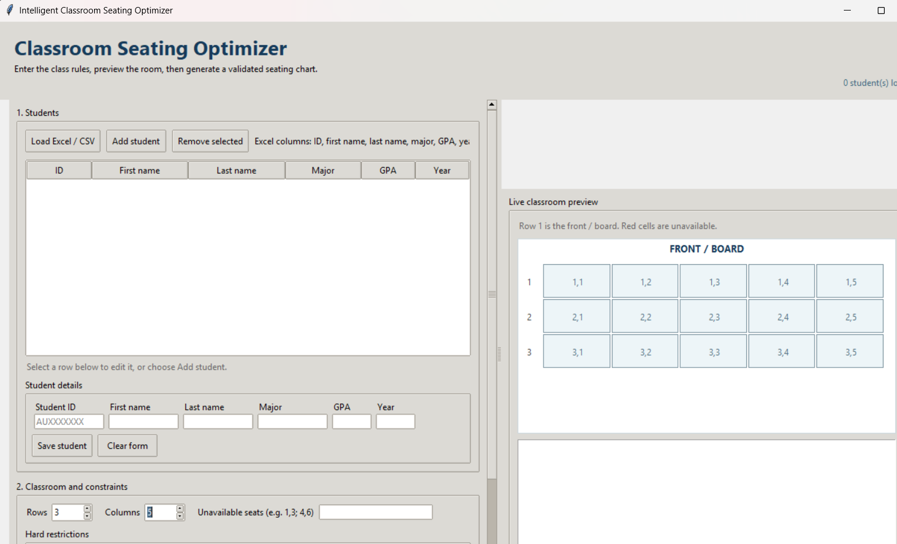

# Intelligent Classroom Seating Optimizer

A faculty-facing classroom seating system that converts student records and classroom rules into a validated seating chart.

The project combines a desktop interface for normal use, a guided Jupyter notebook for demonstrations and submissions, and a dependency-free Python CSP engine underneath.

Course: CSE518: Artificial Intelligence | Monsoon 2026


▶ Submitted by: Devasya Desai | AU2320161 



## Start here

The professor-facing application starts directly with:

```text
python gui.py
```

Other modes:

```text
python main.py           # equivalent UI entry point
python main.py --demo    # command-line demonstration
python main.py --bench   # compare CSP search strategies
python tests.py          # run the regression tests
```

The desktop application uses Python's standard library, including Tkinter. No pandas, openpyxl, or web framework is required.

## Application workflow

1. Load students from an Excel workbook or CSV file, or add students manually.
2. Configure classroom rows, columns, and unavailable seat coordinates.
3. Add hard restrictions such as fixed seats and separated student pairs.
4. Select soft preferences such as low-GPA front placement and major spreading.
5. Generate the seating chart.
6. Review the visual layout, hard-constraint validation, soft score, and search statistics.
7. Save the HTML report only if it is needed.

The application has scrolling panels for smaller laptop screens. To edit a student, select the row and use the Student details form. Manually entered IDs use `AUXXXXXXX` as the placeholder and must be unique.

## Student data

Excel and CSV files may contain these columns:

| Column | Required | Description |
|---|---:|---|
| `ID` or `enrollment ID` | Yes for manual entry; optional for import | Unique student identifier |
| `first name` | Yes | Student's first name |
| `last name` | Yes | Student's last name |
| `major` | Yes | Department or branch |
| `GPA` or `CGPA` | Yes | Numeric GPA from 0 to 10 |
| `year` | No | Stored for future rules; currently not used by the solver |

If an imported file does not contain an ID, the importer creates deterministic demonstration IDs such as `AU2320001`. Real submissions should provide the actual enrollment IDs.

Legacy `.xls` files should be saved as `.xlsx` before importing. `.xlsx` and `.csv` are supported.

## Classroom and constraints

Seats use one-based `(row, column)` coordinates. Row 1 is the front/board.

Examples:

```text
Unavailable seats: 1,9; 6,1
Separated students: AU2320001,AU2320002; AU2320003,AU2320004
Fixed seats: AU2320005=2,3
```

Hard constraints must be satisfied:

- Each student receives at most one seat.
- Students cannot share a seat.
- Unavailable seats cannot be used.
- Fixed seats are respected.
- Separated pairs cannot sit side by side in the same row.
- The optional low-GPA front-row rule can be made hard.

Soft preferences are scored rather than treated as absolute restrictions:

- Prefer students below a GPA threshold in the first selected rows.
- Spread students from the same major across rows.
- Preserve a previous chart when rearranging through the Python API.

If hard restrictions conflict, the system reports that no feasible arrangement exists instead of returning an invalid chart.

## Guided notebook

[theory_and_testing.ipynb](./theory_and_testing.ipynb) follows the same use-case flow as the application without relying on fragile `input()` prompts.

Open it in Jupyter or VS Code, then:

1. Edit the clearly labelled input block.
2. Leave synthetic data enabled to generate demonstration students quickly, or set it to `False` and fill the manual student list.
3. Configure the classroom and restrictions.
4. Run the generation cell.
5. Review the seating chart, validation summary, theory explanation, alphabetical comparison, and optional HTML report.

Synthetic students are explicitly labelled. They exist to demonstrate the system and should not be presented as a real class dataset.

## How the solver works

The seating problem is formulated as a finite-domain Constraint Satisfaction Problem (CSP), following the ideas in Russell and Norvig's *Artificial Intelligence: A Modern Approach*.

- **Variables:** students.
- **Domains:** available `(row, column)` seats.
- **Constraints:** rules that determine whether two assignments may coexist.
- **Backtracking:** assigns students incrementally and undoes choices when a contradiction appears.
- **MRV:** Minimum Remaining Values selects the most constrained student first.
- **Degree heuristic:** breaks MRV ties using the student involved in the most remaining constraints.
- **Forward checking:** removes values that became impossible after each assignment.
- **Value ordering:** tries seats with lower soft cost first.
- **Hill climbing:** improves a feasible result through valid swaps and moves.

Backtracking finds feasibility. The soft-cost improvement is heuristic and does not guarantee a globally optimal arrangement.

## Alphabetical comparison

The notebook and generated comparison report build an alphabetical baseline for the same students and classroom. Fixed seats and unavailable seats remain the same; remaining students are placed alphabetically by name.

The comparison is grounded in measured values:

- Number of hard-constraint violations.
- Number of low-GPA students in the front rows.
- Same-major pairs sharing a row.
- Weighted soft cost.

The report only claims that the generated arrangement is better when its measured weighted cost is lower for the selected preferences.

## Project structure

| File | Purpose |
|---|---|
| [gui.py](./gui.py) | Primary Tkinter desktop application and Excel/CSV import |
| [main.py](./main.py) | Alternate UI entry point, command-line demo, and benchmark |
| [data.py](./data.py) | `Student` model, sample data generation, and legacy CSV loader |
| [csp.py](./csp.py) | Generic backtracking CSP engine and search statistics |
| [seating.py](./seating.py) | Seating CSP, hard validation, soft costs, and hill climbing |
| [report.py](./report.py) | Terminal reports, HTML reports, theory explanation, and alphabetical comparison |
| [tests.py](./tests.py) | Regression tests for core constraints and solver behavior |
| [theory_and_testing.ipynb](./theory_and_testing.ipynb) | Guided application-style notebook |
| [seating_report.html](./seating_report.html) | Example generated HTML report |

## Testing

Run:

```text
python tests.py
```

The tests cover:

- Too many students for the available seats.
- Separation conflicts.
- Fixed and unavailable seats.
- Low-GPA front-row preference.
- A full 48-student classroom with no hard violations.

The benchmark in `main.py --bench` also demonstrates the effect of MRV, degree tie-breaking, and forward checking on a deliberately tight instance.

## Limitations and future work

- The current data importer supports `.xlsx` and `.csv`, not legacy `.xls` directly.
- Synthetic data is for demonstrations only.
- Soft optimization uses hill climbing and can stop at a local minimum.
- “Beside” currently means adjacent columns in the same row.
- The current UI does not yet use academic year as a constraint.
- Larger classes may require more efficient local-search strategies.

Possible extensions include additional spatial constraints, AC-3 arc consistency, simulated annealing or min-conflicts, real-data validation, and configurable previous-chart imports.

## Reference

Russell, S. and Norvig, P. *Artificial Intelligence: A Modern Approach*, 4th Edition, Pearson, 2022. Chapters 4 and 6.
